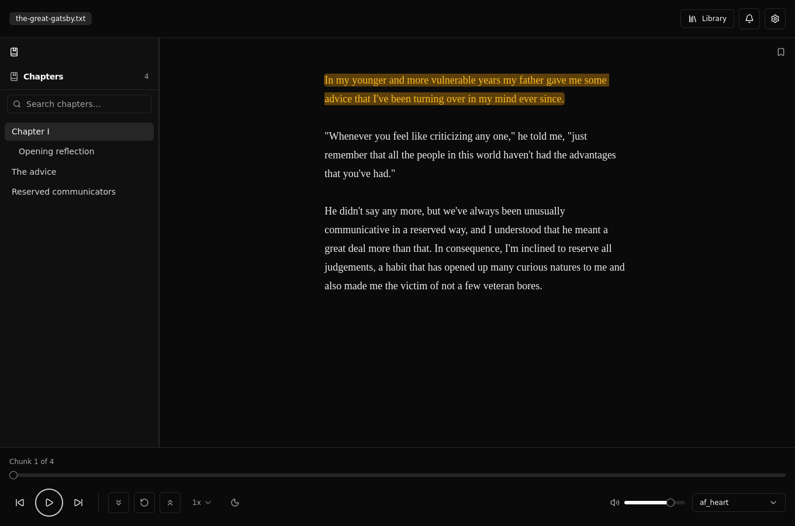
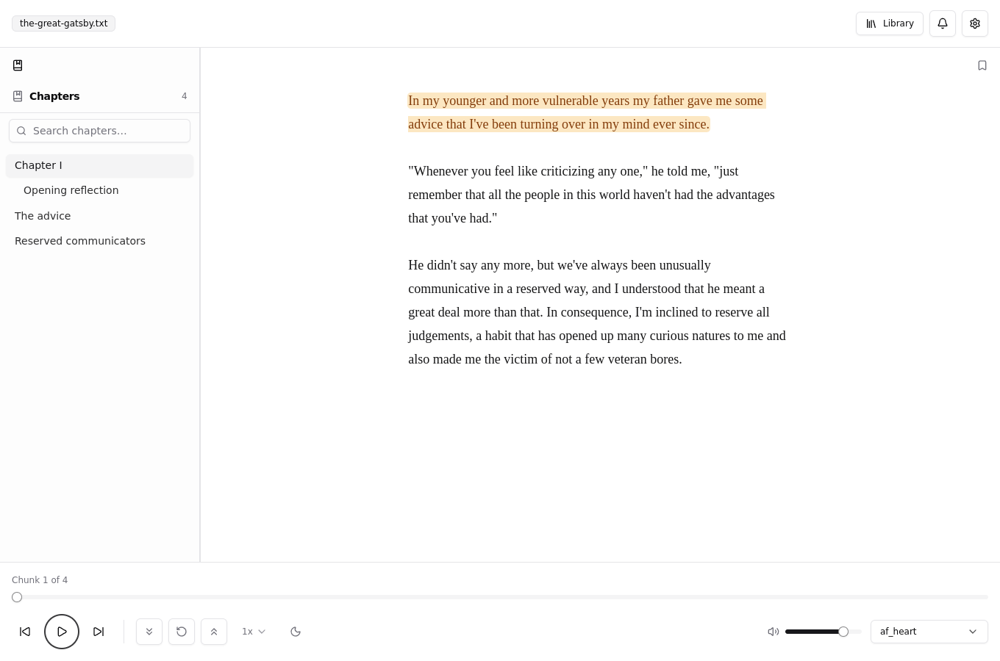
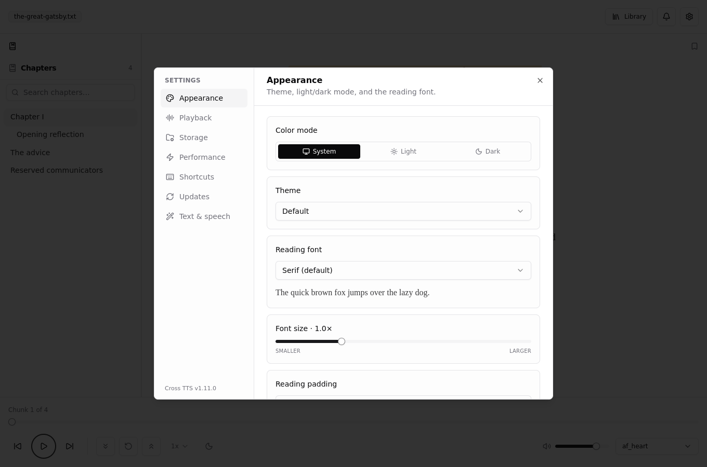

<div align="center">

# Cross TTS

**Turn any book into an audiobook — natural neural voices, fully offline, free.**

[](https://github.com/Emad-K/cross-tts/releases/latest)
[](https://github.com/Emad-K/cross-tts/releases)


Open an EPUB or text file, press play, and listen. Cross TTS reads your books aloud in a natural neural voice — **no account, no subscription, and no internet** once it's set up. The voice runs on your own computer, so nothing you read is ever uploaded anywhere.

[**⬇ Download for Windows · macOS · Linux**](https://github.com/Emad-K/cross-tts/releases/latest)



</div>

## 🎬 Demo

<!--
  Add a real demo VIDEO here so people can hear the voice (a GIF can't carry audio):
  1. Record a ~20–40s clip — open a book, hit play, show the highlight following along.
     Capture WITH system audio so the Kokoro voice is in the clip. (OBS, ShareX, or
     macOS Cmd-Shift-5 all work; export MP4, keep it under 100 MB.)
  2. Edit this README on github.com (the ✏️ button), then drag the .mp4 into the editor.
     GitHub uploads it and drops in a player URL like
     https://github.com/user-attachments/assets/<id> — commit, done.
  A silent GIF of the UI flow is a fine secondary option; put it in docs/media/ and
  reference it as .
-->

> ▶️ _Demo video coming soon — drag an `.mp4` in here on github.com to embed a player with sound._

## Get started in 30 seconds

1. **Download & install** the build for your system from the [releases page](https://github.com/Emad-K/cross-tts/releases/latest).
2. **Open a book** — any `.epub` or `.txt`. (No book handy? Hit **Try sample**.)
3. **Press play.** The first time, it downloads the voice once (a few seconds); after that everything works offline.

## What you can do with it

- 🎧 **Listen to any book in a natural voice.** 28 built-in voices, male and female. Pick the one you like and it reads — chapter after chapter, hands-free.
- ✨ **Follow along as it reads.** The current sentence is highlighted while it's spoken, so it's easy to read *and* listen, or glance up and find your place.
- 🔖 **Always pick up where you left off.** Your books live in a library with covers and progress; reopen one and it resumes at the exact spot — playback position, chapter, and all.
- 💾 **Make a real audiobook file.** Export a whole book to **M4B** (with chapters and cover art) or **MP3** and play it on your phone, car, or any audiobook app.
- 😴 **Sleep timer.** Drift off to a chapter — stop after a set time or at the end of the current chapter.
- ⏩ **Read at your pace.** Speed from 0.75× to 2×, plus an adjustable pause between sentences for a more natural rhythm.
- ⌨️ **Control it like a music player.** Play/pause and skip with your keyboard's media keys or headphones, even when the window is in the background.
- 📖 **Comfortable to read.** Light/dark modes, five themes, adjustable font size and spacing, and an **OpenDyslexic** font option.
- 🔒 **Private by design.** The voice is generated on your machine. No sign-up, no cloud, no tracking of what you read.
- 🗂️ **Watched folders & custom pronunciations** for power users — auto-import new books from a folder, and teach it how to say tricky names (including an optional pinyin pack for Chinese xianxia/wuxia terms).

## Screenshots

| Reading with read-along | Settings |
|---|---|
|  |  |

## Download & install

Grab the file for your system from the [latest release](https://github.com/Emad-K/cross-tts/releases/latest):

| System | File |
|---|---|
| **Windows** | `…-setup-x64.exe` (installer) or `…-portable-x64.exe` (no install) |
| **macOS** | `…-arm64.dmg` (Apple Silicon — M1/M2/M3) or `…-x64.dmg` (Intel) |
| **Linux** | `…-x86_64.AppImage`, `.deb`, or `.rpm` (also `arm64` builds) |

Updates arrive automatically inside the app.

<a id="troubleshooting-linux"></a>
> **Linux: the AppImage won't start on Ubuntu 24.04+.** These releases block the
> user namespaces Chromium's sandbox needs unless an AppArmor profile allows the
> app. The `.deb` and `.rpm` install that profile for you (on AppArmor systems;
> Fedora uses SELinux and needs nothing), but an AppImage can't. Install the
> `.deb` instead, or start the AppImage with `--no-sandbox` (this turns off
> Chromium's sandbox for the app).

> **macOS / Windows note:** the app isn't code-signed yet, so the first launch may show a "unidentified developer" or SmartScreen warning. On macOS: right-click the app → **Open**. On Windows: **More info → Run anyway**.

## System requirements

Cross TTS generates the voice **on your computer**, so playback is as smooth as your hardware. The good news: the voice model (Kokoro-82M) is small and the app renders the next sentences ahead of time, so most machines play with no lag.

**For a lag-free experience:**

- **Best (instant, never waits):** any computer with a graphics card the app can use for acceleration — this is **on by default** and covers most laptops and desktops from roughly the last 6 years, including **Apple Silicon Macs** and built-in Intel/AMD graphics.
- **No supported GPU? The CPU keeps up:** the app falls back to a native CPU engine that generates speech faster than you listen on a modern multi-core processor (measured 3–4× realtime on a recent desktop CPU). Expect a few seconds of model loading per session and a brief pause before the first sentence; very old or busy machines may occasionally pause between sentences.
- **Memory:** 4 GB RAM minimum, 8 GB comfortable.
- **Disk:** roughly a few hundred MB — the app plus the voice files, downloaded once and cached.
- **OS:** Windows 10/11, macOS 12 (Monterey)+, or a current 64-bit Linux desktop.
- **Internet:** only for the one-time voice download, app updates, and the optional NVIDIA CUDA add-on if you ask for it. Reading and listening are **100% offline** after that.

Synthesis settings (use GPU, CPU thread count) live in **Settings → Performance** if you want to tune them.

---

## License

MIT © Emad Kazemi — see [LICENSE](LICENSE).

### Third-party components

Installers bundle third-party packages under their own licences. One worth
calling out: [phonemizer](https://www.npmjs.com/package/phonemizer) (used for
text-to-phoneme conversion) is published as Apache-2.0 but is
built on and ships a compiled copy of [eSpeak NG](https://github.com/espeak-ng/espeak-ng),
which is licensed **GPL-3.0-or-later**. Distributions of Cross TTS therefore
include GPL-3.0+ code, and the eSpeak NG source is available from its
repository linked above.

The optional **Supertonic 3** voice engine (by Supertone Inc.) is not
bundled. When you choose it, its weights are downloaded from
[supertone-oss-archive/supertonic-3](https://huggingface.co/supertone-oss-archive/supertonic-3)
(pinned revision, sha256-verified). The weights are licensed under
**BigScience OpenRAIL-M**. The app shows the licence's use restrictions and
asks you to accept them once before the first download. Those restrictions
include no unlawful use, no impersonation without consent, and disclosing
machine-generated content. A copy of the licence is saved next to the
downloaded model and kept in [third_party/supertonic-3/LICENSE](third_party/supertonic-3/LICENSE).
The inference code in `src/mainview/features/reader/tts/supertonicModel.ts`
is adapted from Supertone's MIT-licensed
[reference implementation](https://github.com/supertone-inc/supertonic).

The optional **Phonon 31M** voice engine (by Gradium, built on Kyutai's
Pocket TTS and Mimi) runs on the bundled
[phonon-tts](https://www.npmjs.com/package/phonon-tts) runtime (MIT or
Apache-2.0; its licence files ship with the app). Its weights and voices,
[gradium/phonon-31m-en](https://huggingface.co/gradium/phonon-31m-en) and
[gradium/phonon-voices](https://huggingface.co/gradium/phonon-voices), are
Apache-2.0 and downloaded on first use (pinned revision, sha256-verified).

Installers also bundle the [ONNX Runtime](https://github.com/microsoft/onnxruntime)
WebAssembly build (MIT, © Microsoft). The notices for it and the Supertone
helper are kept in [third_party/](third_party/) and shipped under the app's
`resources/licenses` folder.

---

<details>
<summary><strong>For developers</strong></summary>

Built with Electron, React, TypeScript, Tailwind, and Vite (electron-vite). TTS is [Kokoro](https://github.com/hexgrad/kokoro) (`onnx-community/Kokoro-82M-v1.0-ONNX`) driven directly through transformers.js 4 on ONNX Runtime 1.31 — WebGPU in a Web Worker when available, otherwise native CPU (`onnxruntime-node`, fp32) in an Electron utility process, with a WASM (q8) Web Worker as the last-resort fallback. onnxruntime-node 1.31 has no Intel-Mac (darwin/x64) binary, so on Intel Macs the native engine is skipped and the CPU path is the WASM worker (about 2.5× slower than native).

**Supertonic 3** (Settings → Playback → Voice engine) is the second engine: four fp32 ONNX graphs (~400 MB) driven directly on ONNX Runtime. It reads 31 languages; a voice is `<lang>:<style>` (10 preset styles). It runs native CPU first (about 7× realtime at the default 8 denoising steps on an 8-core desktop), then WebGPU, then multi-threaded WASM (1.3× realtime measured on its first, warm-up sentence). The quality slider sets the denoising steps (2–16).

**Speech backend (Settings → Performance):** "Auto" keeps the order above.
The picker also lists explicit choices, each only where it can work: GPU
(WebGPU), CPU (native), CPU (WASM), and two GPU providers for the native
Kokoro engine. Any of them falls back to the CPU when it can't start, and
"Run benchmark" times them on request (it never runs on its own).

- **DirectML (Windows, experimental):** ships with the app; nothing to install.
- **NVIDIA CUDA (Linux x64 only):** offered only when the CUDA 13 runtime and
  cuDNN 9 are already installed (ONNX Runtime 1.31's CUDA provider links
  those; CUDA 12 is not enough, and its Windows build has no CUDA). The app
  never installs them. Picking it downloads a one-time 234 MB add-on (ONNX
  Runtime's CUDA provider libraries, SHA-512 pinned) from nuget.org into the
  app-data folder. That click is the only time the app contacts nuget.org.
  The checksum is checked at download time only: the unpacked libraries sit
  in your own app-data folder and are loaded from there afterwards, like any
  other file your user account can change.

```bash
pnpm install
pnpm run dev        # hot-reload dev app
pnpm run typecheck  # tsc --noEmit
pnpm run test       # unit tests (bun test)
pnpm run test:e2e   # Playwright smoke tests against the built app
pnpm run build      # production build
pnpm run dist       # package installers (or dist:win / dist:mac / dist:linux)
```

> **Linux / Node version notes** (handled automatically, but FYI):
> - **Node 22.12+ is required** (Electron's installer needs it; CI uses 22).
>   The `postinstall` step runs Electron's `install-electron` to fetch its binary.
> - On **Ubuntu 24.04+/26.04**, AppArmor restricts unprivileged user namespaces,
>   which breaks Chromium's sandbox for source/dev runs. `pnpm dev` / `pnpm start`
>   go through `scripts/run-electron-vite.mjs`, which detects this and launches
>   with `--no-sandbox` *only when the sandbox can't otherwise work*. Installed
>   `.deb`/`.rpm` packages keep the sandbox on (their post-install adds an
>   AppArmor profile granting user namespaces). The AppImage can't install one;
>   see [Troubleshooting](#troubleshooting-linux).

### Project layout

```
src/
├── bun/        # Electron main process (file I/O, model cache, updates, IPC)
├── preload/    # context-isolated IPC bridge
├── mainview/   # React renderer (reader, library, playback, settings)
└── shared/     # pure logic shared across processes (unit-tested with bun)
e2e/            # Playwright tests against the packaged app
docs/media/     # README screenshots (regenerate: node e2e/capture-screenshots.mjs)
```

### Releasing

Releases are driven by `package.json` — **bump the version in a PR and merge it.** When a push to `main` carries a version with no matching `v<version>` tag, the **Release** workflow builds all three OSes, creates the tag, and publishes the GitHub Release. Pushes that don't change the version are a no-op.

```bash
pnpm version minor   # or patch / major
# open a PR, merge to main → Release publishes v<new-version>
```

`workflow_dispatch` re-runs a release for the current version.

### Contributing

Issues and PRs welcome. CI runs typecheck, unit tests, a three-OS build, and Playwright smoke tests on every PR — `pnpm run build:check && pnpm run test` locally gets you most of the way.

</details>
